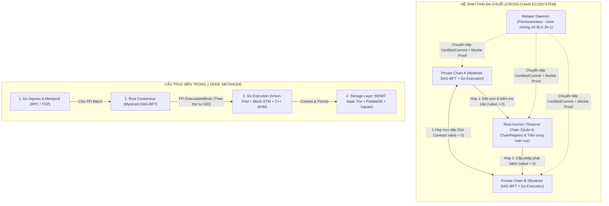
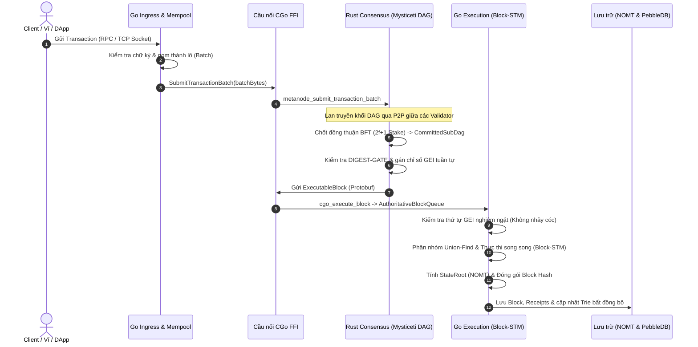
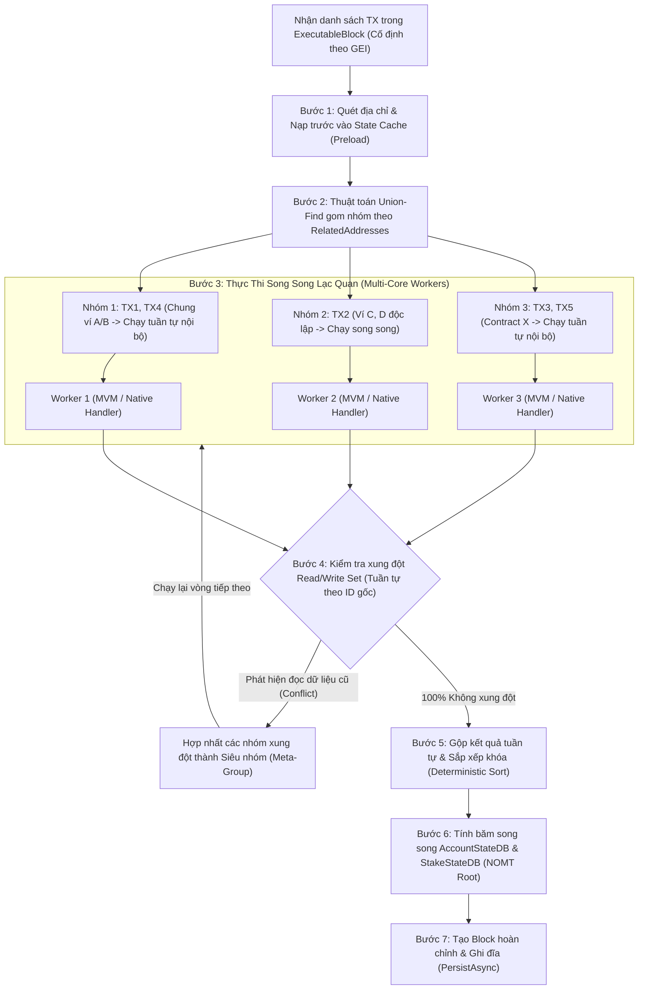
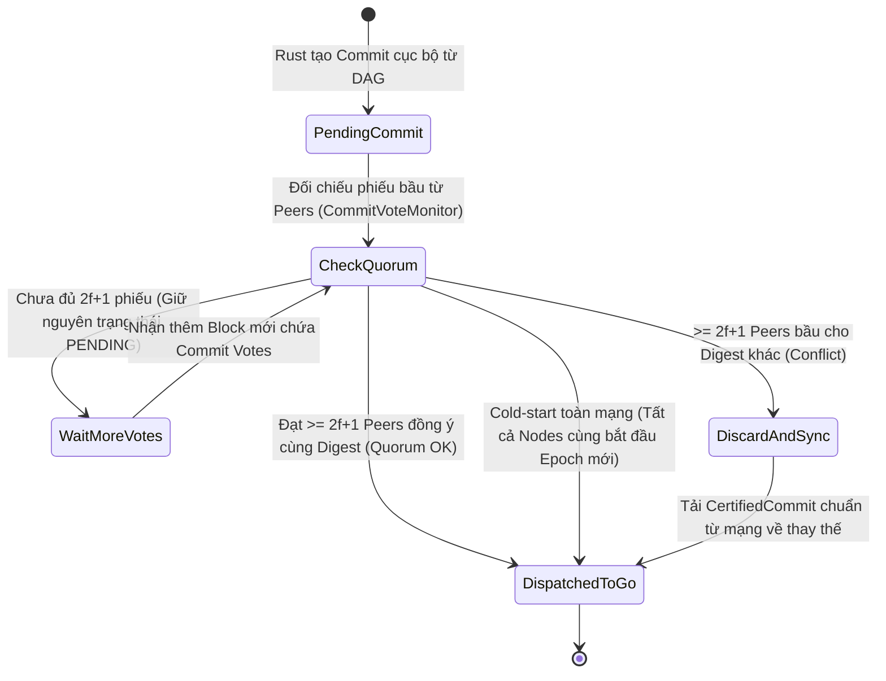
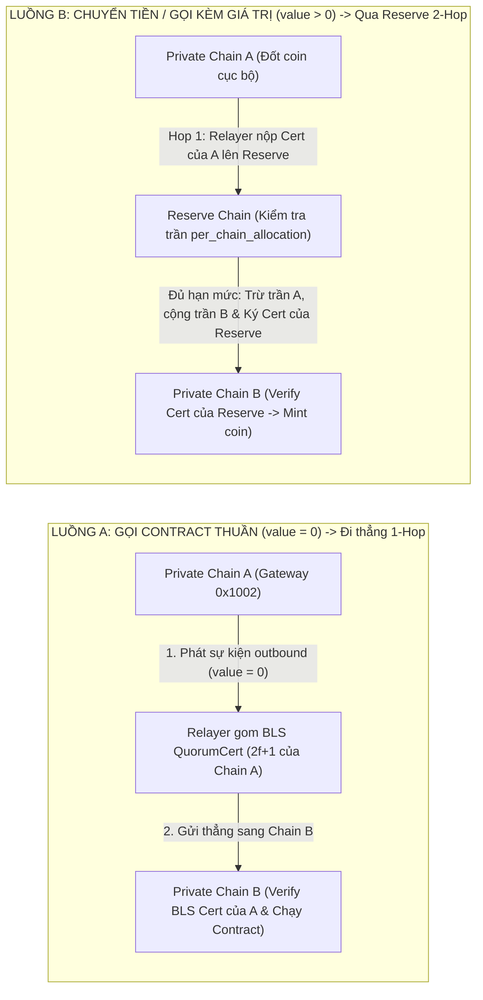
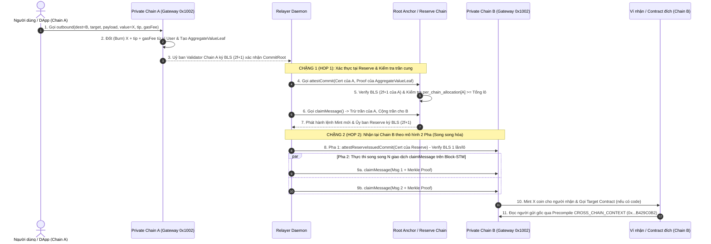
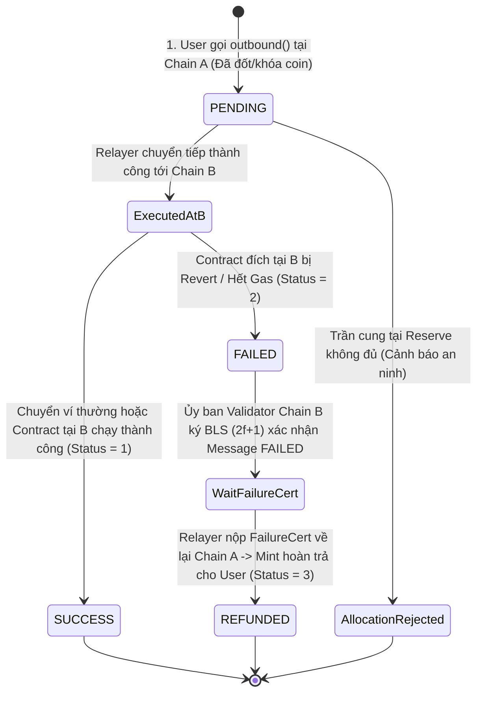
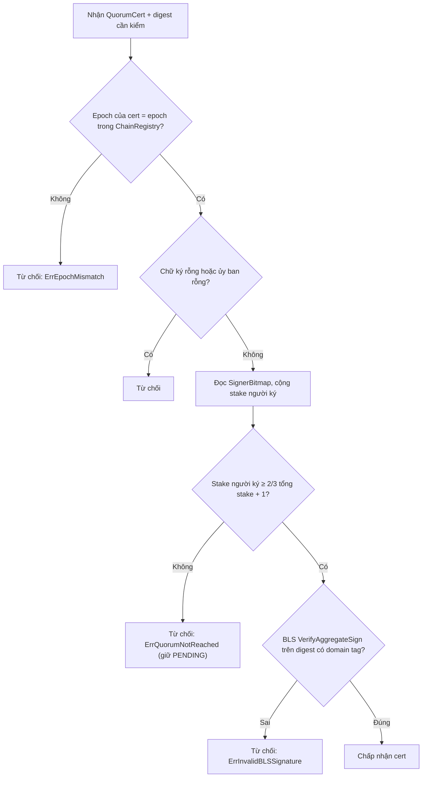

# Báo Cáo Kiến Trúc Luồng Giao Dịch Hệ Thống Metanode
*(Nội bộ Node Thực Thi & Xuyên Chuỗi Liên Mạng)*

> **Mục tiêu tài liệu:** Tổng hợp toàn bộ kiến trúc xử lý giao dịch của hệ thống Metanode hiện tại thành một tài liệu trực quan duy nhất phục vụ báo cáo. Tài liệu tập trung vào **sơ đồ luồng (Flowcharts & Sequence Diagrams)** cho 2 trụ cột chính:
> 1. **Luồng giao dịch nội bộ 1 Node (Intra-Node):** Từ khi nhận giao dịch qua RPC, đồng thuận DAG-BFT trên Rust, đến thực thi song song Block-STM trên Go và lưu trữ NOMT/Pebble.
> 2. **Luồng giao dịch xuyên chuỗi (Cross-Chain):** Từ giao tiếp trực tiếp giữa 2 Private Chain (`value = 0`) đến định tuyến bảo toàn tổng cung qua **Root Anchor / Reserve Chain** (`value > 0`).
> 3. **Ma trận chữ ký (mục 4):** mỗi bước cần chữ ký loại nào, ai ký, ký lên dữ liệu gì, ai verify và điều kiện hợp lệ.

---

## 1. Bức Tranh Tổng Quan Hệ Thống (High-Level Architecture)

Mỗi mạng **Metanode Chain** được vận hành bởi các Node có kiến trúc lai **Go + Rust + C++ (MVM)**. Khi mở rộng ra đa chuỗi (Multi-chain), các Private Chain kết nối với nhau thông qua **Root Anchor Chain (Reserve Chain)** và **Relayer phi tập trung**.

---

## 2. PHẦN I: Luồng Giao Dịch Nội Bộ Node Thực Thi (Intra-Node Flow)

### 2.1. Vòng đời khép kín của 1 Giao dịch (Từ User RPC đến Database)

Sự phân tách trách nhiệm trong 1 Node tuân thủ nguyên tắc **One-way Deterministic Pipeline**:
- **Rust (Consensus)** chỉ chịu trách nhiệm gom giao dịch vào DAG, chạy đồng thuận BFT và chốt thứ tự thực thi toàn cục (`GlobalExecIndex - GEI`).
- **Go (Execution)** nhận khối đã chốt thứ tự từ Rust, chạy máy ảo song song để tính `StateRoot` và lưu xuống đĩa. Go tuyệt đối không tự ý thay đổi thứ tự giao dịch.

---

### 2.2. Cơ chế Thực thi Song song Lạc quan trong Go (Union-Find + Block-STM)

Để đạt thông lượng cao trên CPU đa nhân mà vẫn **đảm bảo 100% không lệch StateRoot (Zero-Fork)** giữa các Node, tầng Go Execution kết hợp **Phân nhóm tĩnh (Union-Find)** và **Thực thi lạc quan (Optimistic Block-STM)**:

| Thành phần trong Pipeline | Vai trò cốt lõi | Cơ chế chống Fork (Zero-Fork Defense) |
| :--- | :--- | :--- |
| **Union-Find Grouping** | Gom các giao dịch chạm cùng địa chỉ ví (`From`/`To`) vào cùng 1 nhóm. | Giao dịch trong cùng nhóm được giữ nguyên thứ tự `ID` xuất hiện trong Block. |
| **Native Address Filtering** | Lọc bỏ địa chỉ hệ thống chung (như `AccountSetting`, `ValidatorContract`) khi gom nhóm. | Cho phép hàng nghìn lệnh đăng ký BLS khác ví chạy song song trên mọi Worker. |
| **Optimistic Block-STM** | Cho phép các nhóm chạy song song và ghi nhận `ReadSet` / `WriteSet` vào bộ đệm. | Pha xác thực duyệt tuần tự theo mảng gốc; nếu trùng ô nhớ động của EVM thì gộp nhóm chạy lại. |
| **Deterministic Merge** | Đẩy dữ liệu `DirtyAddresses` xuống Trie (NOMT) để lấy `StateRoot`. | Bắt buộc sắp xếp mảng địa chỉ (`slices.SortFunc`) trước khi cập nhật Trie để tránh lệch nhánh băm. |

---

### 2.3. Nguyên tắc Chống Fork tại Cổng Đồng Thuận (Zero-Fork Gate)

Trước khi một Commit từ Rust được phép chuyển sang Go để thực thi, hệ thống áp dụng chốt chặn **DIGEST-GATE** dựa trên bằng chứng phiếu bầu từ mạng P2P (`CommitVoteMonitor`), tuyệt đối không dùng `timeout` để tự ý quyết định:

---

## 3. PHẦN II: Luồng Giao Dịch Xuyên Chain (Cross-Chain Flow)

### 3.1. Phân loại 2 luồng định tuyến xuyên chuỗi

Kiến trúc liên chuỗi của Metanode loại bỏ hoàn toàn mô hình "Embassy" tập trung cũ và thay thế bằng **Native Light-Client Bridge (xác thực chữ ký BLS tổng hợp `2f+1` của Ủy ban Validator)** kết hợp với **Root Anchor / Reserve Chain**:

> **Tại sao luồng có giá trị (`value > 0`) bắt buộc đi qua Reserve Chain?**
> Để chống rủi ro **"Mắt xích yếu nhất" (Weakest-Link Risk)**: Một Private Chain dù bị chiếm quyền điều khiển cũng **không thể tự in khống coin** rồi rút sang các chain khác. Reserve Chain đóng vai trò Ngân hàng Trung ương kiểm tra trần cấp phép (`per_chain_allocation[ChainA] >= X`) trước khi ký lệnh cho phép Chain B phát hành (`mint`) số coin tương ứng.

---

### 3.2. Chi tiết Luồng Chuyển Giá Trị (`value > 0`) & Thực Thi Song Song `Attest-then-Claim`

Để tránh điểm nghẽn cổ chai khi xác thực chữ ký BLS (vốn rất nặng CPU) và tận dụng được cơ chế song song **Block-STM** ở chain đích, quá trình nhận giao dịch xuyên chuỗi được tách làm **2 Pha (`Attest-then-Claim`)**:
- **Pha 1 (`attestCommit`)**: Chỉ chạy **1 lần cho cả lô (commit)** để kiểm tra chữ ký BLS `2f+1` và kiểm tra tổng giá trị lô qua nhánh băm `AggregateValueLeaf`.
- **Pha 2 (`claimMessage`)**: Tách thành **N giao dịch nhỏ độc lập** cho từng người nhận. Nhờ không đụng chung vào biến tổng cung hay xác thực BLS lại, các giao dịch `claimMessage` được **Block-STM chạy song song hoàn toàn** trên nhiều nhân CPU.

---

### 3.3. Vòng đời Trạng thái Giao dịch Xuyên Chuỗi & Cơ chế Hoàn Tiền (Refund)

Mọi giao dịch xuyên chuỗi đều tuân thủ nguyên tắc **Không dùng Timeout để tự hoàn tiền** (tránh tạo Fork giữa 2 chain khi mạng trễ). Tiền chỉ được hoàn trả tại Chain nguồn khi có **chứng chỉ BLS `2f+1` xác nhận trạng thái `FAILED`** từ chính Chain đích:

---

## 4. PHẦN III: Ma Trận Chữ Ký — Ai Ký Gì, Ai Verify, Ký Lên Dữ Liệu Nào

Hệ thống dùng **3 họ chữ ký độc lập**, mỗi họ bảo vệ một ranh giới tin cậy khác nhau. Không có chữ ký nào được dùng thay cho chữ ký khác.

| Họ chữ ký | Thuật toán | Bảo vệ ranh giới nào |
| :--- | :--- | :--- |
| **Giao dịch người dùng** | `secp256k1` (ECDSA kiểu Ethereum) | User → Node. Chế độ `bls_legacy` đã bị loại bỏ, node chỉ chấp nhận `secp` (`config.go: validateTxSignatureMode`). |
| **Khối đồng thuận DAG** | `Ed25519` (`ProtocolKeySignature`) | Validator → Validator trong Rust Mysticeti: mỗi block DAG do tác giả ký, node khác verify trong `block_verifier`. |
| **Chứng chỉ liên chuỗi (QuorumCert)** | `BLS12-381` tổng hợp (`blst`) | Chain → Chain. Ủy ban Validator của một chain ký xác nhận, chain khác verify bằng pubkey trong `ChainRegistry`. |

### 4.1. Bảng chi tiết từng chữ ký trong luồng

| # | Ai ký | Ký lên dữ liệu gì | Ai verify, ở đâu | Điều kiện hợp lệ |
| :-: | :--- | :--- | :--- | :--- |
| 1 | **User / DApp** | Giao dịch (kể cả `outbound`, `claimMessage`) | Mempool node nhận **và** mọi validator khi thực thi block (`FilterInvalidSignatures`) | Chữ ký secp256k1 khớp địa chỉ gửi. Tx sai chữ ký bị **loại, không có receipt, không tăng nonce**, giống nhau trên mọi node. |
| 2 | **Tác giả block (validator)** | Block DAG (Ed25519) | Mọi validator khác, trước khi nhận block vào DAG | Chữ ký khớp `authority index` của tác giả; block thiếu hoặc sai chữ ký bị từ chối. |
| 3 | **Validator (commit vote)** | Digest của commit, nhúng trong `commit_votes` của block mình propose | `CommitVoteMonitor` | Đạt `2f+1` phiếu cùng digest thì commit mới được chuyển sang Go (DIGEST-GATE, mục 2.3). |
| 4 | **Validator chain nguồn (BLS)** | `CommitRoot` của lô outbound, kèm domain tag, chứa cả `AggregateValueLeaf` | Reserve (Hop 1) qua `attestCommit` | `QuorumCert` đúng `Epoch`, tổng stake người ký ≥ ngưỡng (xem 4.2). |
| 5 | **Ủy ban Reserve (BLS)** | Commit mà Reserve đã phát hành/cấp phép | Chain đích (Hop 2) qua `attestReserveIssuedCommit` | Cùng quy tắc `QuorumCert`, verify **1 lần cho cả lô**. |
| 6 | **Ủy ban chain đích (BLS)** | `MESSAGE_FAILURE_ATTEST_V1:` + `messageID` + `destChainID` | Chain nguồn khi `Refund` | `FailureCert` đúng epoch của chain đích. Đây là điều kiện **duy nhất** để hoàn tiền (không dùng timeout). |
| 7 | **Ủy ban chain đích (BLS)** | `MESSAGE_SUCCESS_ATTEST_V1:` + `messageID` + `destChainID` | Reserve khi `CreditReserveAllocation` | Chứng minh message **đã thành công thật** trước khi cộng trần cho chain đích, chống in khống trần. |
| 8 | **Ủy ban chain (BLS)** | `ComputeTransferAllocationMessage(from, to, amount, nonce)`, `ComputeAllocateSupplyMessage`, `ComputeUnregisterChainMessage(chain, epoch, nonce)` | Reserve: `TransferAllocationWithCert`, `AllocateSupplyWithCert`, `UnregisterChainWithCert` | `nonce` phải khớp nonce hiện tại của chain, nên cert cũ không phát lại được. |
| 9 | **Ủy ban chain cũ (BLS)** | `ComputeCommitteeUpdateDigest(chain, newEpoch, newCommittee, stateRoot, accountTreeRoot)` | Reserve khi đổi ủy ban (`epoch_sync`) | Ủy ban epoch hiện tại ký trao quyền cho ủy ban epoch kế tiếp. |
| 10 | **Validator mới đăng ký (BLS PoP)** | `BLS_POP_METANODE_ROOT_ANCHOR_V1:` + pubkey của chính mình | Reserve khi đăng ký ủy ban (`PopVerify`) | Chứng minh sở hữu private key, chống tấn công rogue-key khi gộp chữ ký. |
| 11 | **Relayer** | Chỉ ký giao dịch gửi đi bằng khóa secp256k1 của chính relayer, như mọi tx thường | Mempool và validator của chain nhận | Relayer **không có quyền xác nhận**. Quyền nằm ở `QuorumCert` + Merkle proof bên trong dữ liệu, nên ai cũng làm relayer được. |

### 4.2. Quy tắc verify `QuorumCert` (áp dụng cho các dòng 4–9)

`QuorumCert` gồm `Epoch`, `AggregateSignature` (BLS tổng hợp) và `SignerBitmap` (bit thứ *i* = validator thứ *i* trong ủy ban có ký). Hàm `VerifyQuorumCertAgainstRegistry` thực hiện:

1. **Ủy ban rỗng** hoặc **chữ ký rỗng** thì từ chối ngay.
2. Đọc `SignerBitmap`, cộng stake của những validator được đánh dấu là đã ký. Chỉ pubkey của nhóm này được đưa vào verify.
3. **Ngưỡng:** `accumulatedStake ≥ (2 × totalStake)/3 + 1` (mặc định). Nếu registry khai báo `QuorumThreshold` riêng thì dùng giá trị đó, nhưng không bao giờ thấp hơn **6667 bps (2/3)** (`ValidateQuorumThreshold`).
4. **Verify BLS:** một người ký dùng `VerifySign`; nhiều người ký dùng `VerifyAggregateSign` trên cùng một digest.
5. **Epoch phải khớp** epoch của registry (`ErrEpochMismatch`). Cert của ủy ban cũ không dùng được cho ủy ban mới.

### 4.3. Các lớp chống giả mạo và phát lại

- **Domain separation:** mỗi loại chứng chỉ có tag riêng (`COMMIT_ROOT_SCOPED_ATTEST_V1:`, `MESSAGE_FAILURE_ATTEST_V1:`, `MESSAGE_SUCCESS_ATTEST_V1:`, `BLS_POP_METANODE_ROOT_ANCHOR_V1:`). Chữ ký của loại này không dùng được cho loại khác. Leaf Merkle dùng tiền tố `0x00`, nút trong dùng `0x01` (RFC 6962).
- **Ràng buộc chain + epoch:** digest dùng để slash equivocation chứa `chainID` và `epoch`, nên không phát lại chéo chain hoặc chéo epoch.
- **Ràng buộc nonce:** các lệnh quản trị ngân sách (`TransferAllocation`, `Unregister`) ký lên nonce hiện hành, cert cũ bị từ chối.
- **Proof-of-Possession:** bắt buộc khi đăng ký validator, vì chữ ký BLS được gộp.
- **Không tin chữ ký cục bộ của proposer:** mọi validator tự verify lại chữ ký tx khi thực thi block. Chỉ tin mempool của node đề xuất sẽ mở lỗ hổng một proposer Byzantine chèn tx giả.
- **Cờ tắt verify chỉ cho devnet:** `SKIP_MEMPOOL_SIG_VERIFY` và `METANODE_DEVNET_SKIP_EXEC_SIG_FILTER` yêu cầu thêm `METANODE_DEVNET=true`, **không được dùng ở production**.

> **Chi phí:** verify BLS nặng CPU (cấp độ ~0.6–0.7 ms/chữ ký ở mức sàn trong phép đo trước đó). Vì vậy `attestCommit` verify **1 lần cho cả lô** rồi N `claimMessage` chỉ cần Merkle proof, không verify BLS lại (mục 3.2). `[ĐO]` đó đến từ ghi chú nội bộ của lần đo ngày 2026-09-30, chưa đo lại trong phiên này.

---

## 5. Bảng Tóm Tắt Các Địa Chỉ & Thành Phần Cốt Lõi

| Thành phần / Địa chỉ | Phạm vi | Chức năng chính |
| :--- | :--- | :--- |
| **`GatewayPrecompile`** (`0x0000000000000000000000000000000000001002`) | Có mặt trên mọi Chain | Cổng giao tiếp ABI chuẩn cho mọi lệnh `outbound`, `attestCommit`, `claimMessage`, `refund`, và tra cứu trạng thái `getMessageStatus`. |
| **`CROSS_CHAIN_CONTEXT`** (`0x00000000000000000000000000000000B429C0B2`) | Có mặt trên mọi Chain | Precompile độc lập giúp Smart Contract ở chain đích đọc chính xác người gửi gốc (`getOriginalSender()`) và chain nguồn (`getSourceChainId()`). |
| **`AccountSetting` & `ValidatorContract`** | Nội bộ mỗi Chain | Hợp đồng hệ thống quản lý khóa BLS và danh sách Validator; được lọc khỏi Union-Find để chạy song song tối đa. |
| **`ChainRegistry` & `GlobalSupplyLedger`** | Trên Root Anchor Chain | Lưu danh sách Ủy ban Validator (`committee`), `state_root` mỗi epoch và trần cấp phép tổng cung (`per_chain_allocation`) của từng Private Chain. |
| **NOMT (Nearly-Optimal Merkle Trie) & PebbleDB** | Tầng Lưu trữ (Storage) | Cơ sở dữ liệu trạng thái tài khoản/hợp đồng và lưu trữ chuỗi khối tốc độ cao. |

---

## 6. Danh Mục Tài Liệu Chi Tiết Trong Repo (Để Tra Cứu Sâu)

1. **Luồng giao dịch Go ↔ Rust (Step-by-step):** [block_flow_go_rust.md](file:///home/abc/chain-n/metanode/consensus/metanode/docs/block_flow_go_rust/block_flow_go_rust.md)
2. **Quy trình tạo Block & 10 lớp chống Fork:** [block_creation_architecture.md](file:///home/abc/chain-n/metanode/note/block_creation_architecture.md)
3. **Kiến trúc xử lý Block & Phân loại giao dịch:** [BLOCK_PROCESSING_ARCHITECTURE.md](file:///home/abc/chain-n/metanode/docs/BLOCK_PROCESSING_ARCHITECTURE.md)
4. **Kiến trúc thực thi song song (Union-Find & Block-STM):** [TRANSACTION_PROCESSING_ARCHITECTURE.md](file:///home/abc/chain-n/metanode/note/TRANSACTION_PROCESSING_ARCHITECTURE.md)
5. **Kiến trúc Liên chuỗi Root Anchor & Light-Client Bridge:** [cross_chain_root_anchor_architecture.md](file:///home/abc/chain-n/metanode/note/cross_chain_root_anchor_architecture.md)
6. **Hướng dẫn tích hợp Cross-Chain cho DApp:** [dapp_cross_chain_developer_guide.md](file:///home/abc/chain-n/metanode/note/dapp_cross_chain_developer_guide.md)

